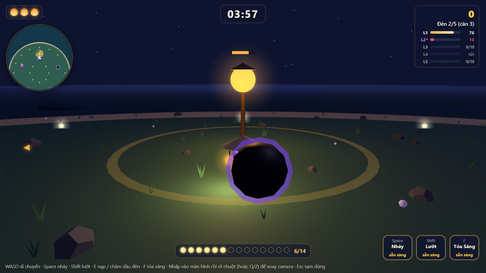

# Đảo Đèn Lồng

**Video demo:** không có (bài nộp này không quay video; bằng chứng thay thế nằm ở [docs/proof](docs/proof/phase-4/README.md)) · **Release:** [v1.0.0](https://github.com/datnguyen101004/K5-L3A-DAY12-PhamNguyenTatDat-2A202603401-AI-SDLC-Dao-Den-Long/releases/tag/v1.0.0)

Game 3D góc nhìn thứ ba chạy trên trình duyệt. Mây, người giữ đèn nhỏ tuổi, gom đom đóm để thắp và **giữ cho các Đèn Lồng Lớn còn sáng tới bình minh** qua 3 Đêm (Đảo Bến, Đảo Cau, Đảo Chuông), trong khi Bóng Mực tìm tới những ngọn đèn yếu để hút dầu.



## Yêu cầu hệ thống
- Node.js ≥ 20 (đã thử với 22), macOS / Linux / Windows.
- Trình duyệt có WebGL2 (Chrome, Edge, Firefox, Safari bản mới).
- Benchmark cần cửa sổ đồ họa (Electron được cài cùng `npm install`, khoảng 100 MB).

## Cài đặt và chơi (3 lệnh)
```bash
git clone https://github.com/datnguyen101004/K5-L3A-DAY12-PhamNguyenTatDat-2A202603401-AI-SDLC-Dao-Den-Long.git dao-den-long && cd dao-den-long
npm install
npm start            # mở http://localhost:8081
```
Bản phát hành (Release v1.0.0) không cần `npm install`: giải nén rồi chạy `node server.js`.

## Điều khiển (đổi được trong Cài đặt)
| Phím mặc định | Việc |
|---|---|
| W A S D | Di chuyển theo hướng camera |
| Space | Nhảy |
| Shift | Lướt (14 m/s, 0.2 s, hồi 1.5 s) |
| E | Thắp đèn / châm dầu (trong 2 m) |
| F | Tỏa Sáng: làm choáng Bóng Mực (3 đom đóm, hồi 3 s) |
| Chuột hoặc Q / Z | Xoay camera |
| Esc hoặc P | Tạm dừng |
| F3 | Hiện FPS |

## Luật chơi
- Thắp đèn lần đầu cần 10 đom đóm (đèn có 100 dầu), thắp lại đèn đã tắt cần 5. Dầu hao 1/giây; mỗi đom đóm châm thêm 10. Dưới 30 dầu đèn nhấp nháy và mất vùng an toàn 6 m.
- **Thắng** khi trời sáng (240 / 270 / 300 s) mà còn sống và còn ít nhất 60% số đèn đang sáng (3/5, 4/6, 5/7). **Thua** khi hết Ngọn Lửa hoặc bình minh tới mà đèn sáng chưa đủ.
- Bóng Mực đuổi Mây trong 12 m, khi lang thang thì tới hút dầu đèn yếu (5 dầu/giây). Gió Lạc (Đêm 2-3) cướp đom đóm. Bùa Gió tăng tốc và cho lướt liên tục 10 s. Rơi khỏi đảo mất 1 Ngọn Lửa.
- Sức chứa đom đóm = 10 + 2 × số lần thắp thành công (tối đa 20).
- **Điểm:** +5 mỗi đom đóm nạp, +100 thắp lần đầu, +40 thắp lại, +5 mỗi Bóng Mực trúng Tỏa Sáng (+15 nếu nó đang hút dầu); khi thắng: mỗi đèn sáng +50 + phần nguyên của dầu, mỗi Ngọn Lửa +50. Tổng điểm là tổng các Đêm đã thắng.

## Bảng xếp hạng
Sau màn Bình Minh hoặc sau khi thua, nhập tên (3-12 ký tự: chữ, kể cả tiếng Việt có dấu, số, `_`) để lưu. Top 10, điểm cao xếp trước, bằng điểm thì ai đạt trước xếp trên. Dữ liệu nằm ở `data/leaderboard.json` (đổi chỗ bằng biến `DDL_DATA_DIR`), còn nguyên sau khi tắt game. Xem từ menu chính → **Bảng xếp hạng**.
```bash
node server.js --export-leaderboard out.json     # {"entries": [...]} theo đúng thứ hạng
```

## Dễ tiếp cận (Cài đặt)
Đổi phím cho mọi hành động (báo trùng phím, nút khôi phục mặc định) · phụ đề và chỉ báo hình ảnh (Bóng Mực xuất hiện kèm mũi tên ở mép màn hình, gió sắp thổi, 10 giây cuối, đèn dưới 30 dầu) · giảm chuyển động (tắt rung camera và chớp màn hình) · chữ ≥ 18 px ở 1280×720 và tùy chọn chữ lớn ×1.25 · bảng màu dễ phân biệt. Mọi cài đặt được lưu.

## Kiểm thử, headless, benchmark, soak
```bash
npm test                                                     # 73 test: luật, headless CLI, soak, bảng xếp hạng, benchmark
node src/headless.js --seed 1 --night 1 --ticks 600 --out out.jsonl [--scenario s.json] [--inputs i.json] [--snapshot-every 10]
node scripts/bench.mjs --seed 42 --duration 30 --out bench.json
node --expose-gc --lite-mode --no-expose-wasm src/soak.js --seed 7 --nights 10 --out soak.json
```
- **Headless** theo Test Contract v1.3 (`game.contract.json`). Mã thoát: 0 thành công, 2 nếu file scenario/inputs sai định dạng, 1 nếu tham số sai.
- **Benchmark** mở cửa sổ Electron (Chromium) 1280×720, vẽ đúng 1280×720 điểm ảnh, **tắt vsync** (`--disable-gpu-vsync --disable-frame-rate-limit`). Cảnh chuẩn: Đêm 1 với đầy đủ ánh sáng và bloom, 200 Bóng Mực lang thang, 100 đom đóm, đèn L1-L3 sáng; camera bay vòng bán kính 30 m, cao 15 m, ngược chiều kim đồng hồ khi nhìn từ trên xuống, 15 s một vòng; 3 s khởi động rồi đo. Phần trang trí sáng tạo (cỏ, hoa, đá) tắt trong cảnh này. `peak_mem_mb` là tổng RSS (working set) của mọi tiến trình Electron. Lần chạy đầu tiên sau khi cài có thể chậm hơn vì hệ điều hành quét file mới và tạo cache shader.
- **Soak** chạy 10 Đêm liên tiếp trong một tiến trình với input ngẫu nhiên theo seed. `--lite-mode` là chế độ bộ nhớ thấp của V8; heap thực của game (`heap_used_*`) giữ nguyên dù có hay không có cờ này.

Kết quả của tôi: [`docs/proof/phase-4/`](docs/proof/phase-4/README.md).

## Cấu trúc
`src/sim.js` (toàn bộ luật, thuần) · `src/maps.js` · `src/campaign.js` · `src/headless.js` · `src/soak.js` · `src/bench.js` · `src/leaderboard.js` · `server.js` (web + bảng xếp hạng) · `web/` (three.js, HUD, âm thanh, tiếp cận) · `scripts/` (bench, proof) · `tests/` · `docs/` (spec, ADR, giả định, bằng chứng, nhật ký AI, retro) · `AGENTS.md` + `.claude/` (harness AI).

## Sáng tạo của tôi
- Bản đồ nhỏ xoay theo camera, bảng dầu từng đèn, thông báo sự kiện, đèn lồng kiểu Hội An, hiệu ứng phát sáng (bloom), mô hình Mây đội nón lá, cỏ hoa trang trí.
- Bóng Mực tìm đường quanh vách, qua cầu tre, lên dốc khi bị chặn.
- Tất cả phần sáng tạo chỉ nằm ở `web/` hoặc giữ nguyên đầu ra headless (`npm test` vẫn đạt; trang trí tắt trong benchmark).

## Tài liệu
[Giả định](docs/notes/assumptions.md) · [Spec Ticket-02](docs/spec/ticket-02.md) · [Spec Ticket-03](docs/spec/ticket-03.md) · [ADR 0001](docs/adr/0001-lantern-fuel-and-dawn-victory.md) · [CHANGELOG](CHANGELOG.md) · [Nhật ký AI](docs/notes/ai-log.md) · [Retro](docs/notes/retro.md) · Bằng chứng: [Phase 1](docs/proof/phase-1/README.md) · [Phase 2](docs/proof/phase-2/README.md) · [Phase 3](docs/proof/phase-3/README.md) · [Phase 4](docs/proof/phase-4/README.md) · [CREDITS](CREDITS.md) · [LICENSE](LICENSE)
