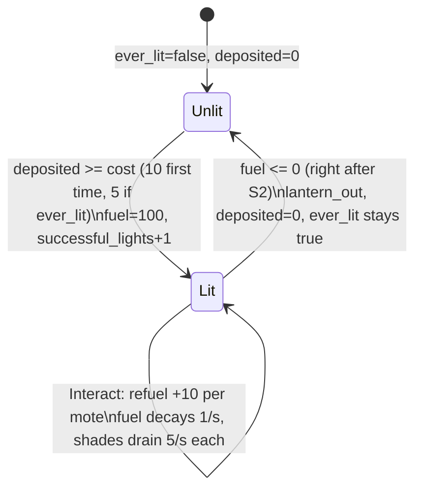

# ADR 0001: Lantern fuel model and "survive to dawn" victory (Ticket-03, Contract v1.2)

Status: accepted · Date: Phase 3 · Supersedes: the Ticket-02 lantern model (`lit` + `deposited`) and the "all lanterns lit => win" rule.

## Context
Playtests showed skilled players lighting every lantern in two minutes and the game ending. The designer wants tension until the end of the night: lanterns can go out, and the goal becomes "keep the island lit until dawn".

## Decision
**1. A lantern is a small state machine with fuel.**

State per lantern: `lit`, `fuel`, `deposited`, `ever_lit`, `relit_count`. The safe zone is a derived property, `lit && fuel >= 30` (`Game.hasZone`), not stored state.

**2. Fuel is an integer in 1/60 units** (`FU = 60`; 100 fuel = 6000 units). Decay is 1 unit per tick, draining is 5 units per tick per shade, a mote is worth 600 units. Rejected alternative: floating point `fuel -= 1/60`. It accumulates error, so the exact thresholds the ticket cares about (`fuel < 30` versus exactly 30, `ceil((100 - fuel)/10)`) would flip nondeterministically. Output is rounded to 1 decimal only when written.

**3. Victory is evaluated once, at the end of the tick, and only when time is up.** `S11`: no flames => `lost/no_flames`; else if `timeLeft <= 0` => `won/dawn_survived` when lit lanterns `>= ceil(0.6 x total)` else `lost/dawn`. The old early `all_lit` exit is removed. Because lanterns are updated in S2 (decay, drain, "goes out") before S11, a lantern that runs dry on the dawn tick no longer counts.

**4. Shade AI gains one state, `drain`.** A *wandering* shade targets the nearest lit lantern with fuel < 30, otherwise the nearest unlit one, and drains a weak lantern from <= 2 m. Exit conditions are checked before anything else on the shade's move (lantern out, fuel >= 30, pushed > 2 m away => `wander`; Mây within 6 m => `chase`; Tỏa Sáng => `stunned`). Drain itself is applied in S2 so "fuel <= 0 => out" can run right after it.

**5. Capacity and score are derived from counters** (`successful_lights`, per-lantern fuel), not from the lantern state, so scenario-placed lanterns never change them.

## Consequences
- Contract `v1.2`: new tuning keys, `fuel/ever_lit/relit_count` in snapshots, `capacity`, `drain` state, events `refuel`, `lantern_out`, `fuel_drain`, `lantern_lit.relight`; `game_over.reason` gains `dawn_survived`, loses `all_lit`.
- Night lengths shrink to 240/270/300 s; the time bonus is gone.
- Tests: see `CHANGELOG.md` for which Phase 2 tests were rewritten and why. No test was skipped.
- Cost: Night 3 headless is slower (about 1.7 s per 21,600 ticks, was 0.25 s) because wandering shades now path-find to lanterns. Still far inside the 30 s budget.
- Risk: the ticket leaves wander speed, drain start tick and `fuel_drain` cadence open; see assumptions A35-A49.
